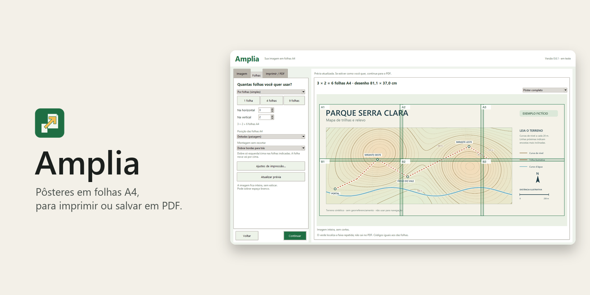
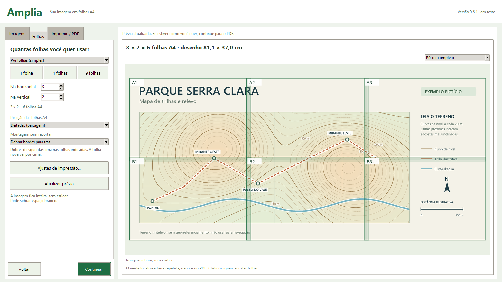
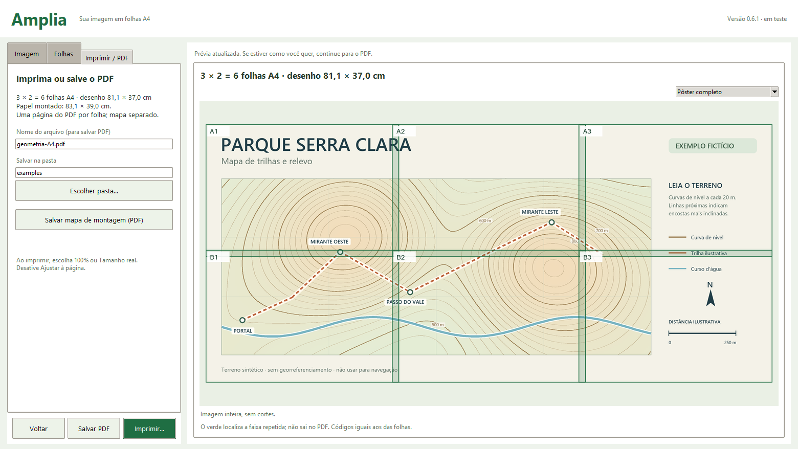
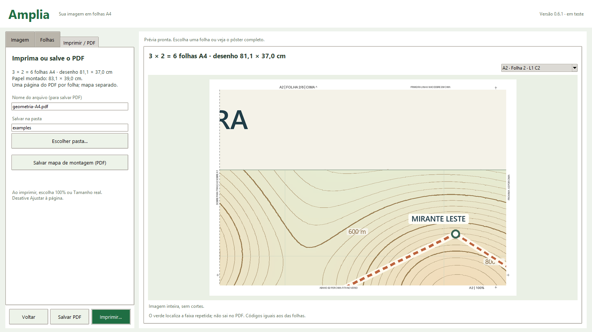
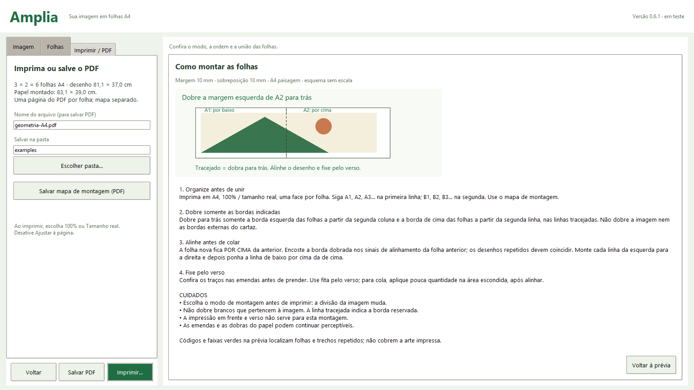
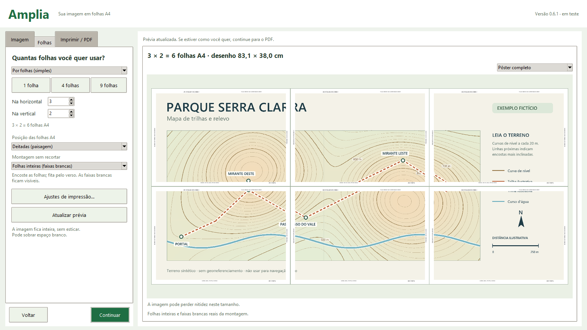

<!-- Amplia · © 2026 Heraldo Antunes · SPDX-License-Identifier: MIT -->
<p align="center"></p>

<h1 align="center">Amplia </h1>

<p align="center"><b>Amplie imagens em pôsteres para imprimir em folhas A4.</b><br>
Escolha a imagem, defina quantas folhas quer usar e confira a montagem.<br>
Imprima ou salve o PDF. Livre, gratuito e sem internet.</p>

<p align="center">
  
  <a href="#sistemas"></a>
  
  <a href="LICENSE"></a>
  
  <br>
  <a href="https://github.com/HeraldoAntunes/amplia/actions/workflows/testes.yml"></a>
  <a href="https://scorecard.dev/viewer/?uri=github.com/HeraldoAntunes/amplia"></a>
  <a href="https://doi.org/10.5281/zenodo.23868491"></a>
  <a href="https://github.com/HeraldoAntunes/amplia/releases/tag/v0.6.1-rc.1"></a>
  <a href="https://github.com/HeraldoAntunes/amplia/releases"></a>
</p>

<p align="center">
  <a href="https://github.com/HeraldoAntunes/amplia/releases/tag/v0.6.1-rc.1"><b>⬇ Baixar o Amplia para testar</b></a>
  &nbsp;·&nbsp; <a href="docs/GUIA-DE-USO.md">Guia de uso</a>
  &nbsp;·&nbsp; <a href="#programas-livres-">Programas Livres</a>
</p>

<p align="center"></p>

<p align="center">
  <a href="#qual-arquivo-baixar">Baixar</a> · <a href="#como-é">Como é</a> · <a href="#recursos">Recursos</a> ·
  <a href="#sistemas">Sistemas</a> · <a href="#atalhos-de-teclado">Atalhos</a> ·
  <a href="#perguntas-frequentes">Perguntas</a> · <a href="#programas-livres-">Programas Livres</a>
</p>

### Qual arquivo baixar?

Pré-lançamento atual: **0.6.1-rc.1**, para testes. O programa mostra o código **0.6.1 · em teste**.

Esta candidata inclui os dois modos de montagem sem recorte. A geometria, os PDFs e a impressão
virtual foram conferidos; a clareza e o alinhamento na montagem em papel ainda precisam de avaliação.

| Para quê | Baixar |
|---|---|
| **Usar sem instalar no Windows, inclusive em pendrive** | [**Amplia-0.6.1-rc.1-portatil.zip**](https://github.com/HeraldoAntunes/amplia/releases/download/v0.6.1-rc.1/Amplia-0.6.1-rc.1-portatil.zip) |

Extraia o ZIP inteiro e abra **Amplia.exe**, dentro da pasta **Amplia**. Mantenha as pastas `app` e `runtime`
junto do executável. O Python já acompanha o pacote; não é preciso instalá-lo no computador.

- **Grátis e livre:** licença [MIT](LICENSE). Use, copie e distribua mantendo o aviso de licença.
- **Sem internet, sem conta, sem anúncios:** a imagem é processada no computador.
- **Em desenvolvimento:** esta publicação é uma candidata de teste. As mudanças estão nas [novidades](CHANGELOG.md).

> **Aviso:** projeto independente, fornecido no estado em que se encontra, **sem garantia de qualquer tipo**.
> A impressão em papel ainda precisa de validação. A sessão fica na memória; salve o PDF para guardar o resultado.
> As marcas citadas pertencem aos respectivos donos; não há vínculo com elas.

## Como baixar e usar no Windows

1. Abra a [página da candidata](https://github.com/HeraldoAntunes/amplia/releases/tag/v0.6.1-rc.1) e baixe o ZIP portátil.
2. Clique com o botão direito no ZIP e escolha **Extrair tudo**. Abra a pasta extraída e depois **Amplia.exe**.
3. Na aba **Imagem**, use **Escolher imagem…** para navegar pelas pastas e unidades do computador.
4. Na aba **Folhas**, escolha um atalho de tamanho ou informe quantas folhas quer na horizontal e na vertical.
5. Confira a prévia e avance para **Imprimir / PDF**. Clique em **Imprimir…** ou escolha nome e pasta e use **Salvar PDF**.

O programa pede confirmação antes de substituir um PDF existente. Para guardar outra versão do trabalho,
escolha outro nome. Ainda não há instalador nem atualização automática.

### Conferir o arquivo baixado

Baixe também o [SHA256SUMS.txt](https://github.com/HeraldoAntunes/amplia/releases/download/v0.6.1-rc.1/SHA256SUMS.txt).
Na pasta do download, execute:

```powershell
certutil -hashfile Amplia-0.6.1-rc.1-portatil.zip SHA256
```

Compare o resultado com a linha do ZIP no arquivo de somas. Os anexos também têm assinatura Sigstore,
identificada pelos arquivos `.sigstore.json`. Veja a [política de segurança](.github/SECURITY.md).

## Como é

As telas abaixo são capturas do aplicativo, com um mapa fictício de trilhas e curvas de nível. O exemplo usa **3 × 2 = 6 folhas A4
em paisagem**, no modo com dobra, com 10 mm de margem e de sobreposição. A grade verde aparece somente na prévia.

| Escolher as folhas e conferir o pôster | Imprimir ou salvar o PDF |
|---|---|
|  |  |
| **Conferir uma folha individual** | **Entender a dobra e a montagem** |
|  |  |

### Exemplos para experimentar

Abra **Usar imagem de exemplo** para começar pelo mapa. Os três arquivos acompanham o portátil,
na pasta `app/examples`; para trocar, use **Escolher imagem…**.

- [**Mapa Serra Clara**](examples/mapa-serra-clara.png): trilhas, curvas de nível e detalhes de relevo.
- [**Suporte de fixação**](examples/peca-suporte.png): peça com cotas e uma vista em perspectiva.
- [**Festa entre estrelas**](examples/festa-entre-estrelas.png): cartaz de aniversário para decorar uma comemoração.

<p align="center"></p>

São exemplos fictícios. O mapa não serve para navegação; a peça não é um projeto para fabricação.
As medidas e a escala visual mudam ao ampliar. Veja os [detalhes e a origem dos exemplos](examples/README.md).
O [guia de uso](docs/GUIA-DE-USO.md) explica cada etapa.

## Recursos

- **Abrir imagens:** PNG, JPEG, WebP, BMP e TIFF, com seleção pelas pastas e unidades do Windows.
- **Escolher o tamanho:** atalhos de uma, quatro ou nove folhas; outras grades por quantidade na horizontal e na vertical.
- **Usar medidas:** largura e altura do pôster em milímetros, com a imagem inteira, centralizada e sem esticar.
- **Preparar as folhas:** A4 em pé ou deitadas, borda branca e escolha entre dobrar bordas ou manter folhas inteiras.
- **Conferir antes de imprimir:** prévia do pôster completo, identificação das folhas e visualização de cada página.
- **Imprimir:** escolha da impressora, intervalo e cópias na janela do Windows, em tamanho real.
- **Salvar PDF:** uma página por folha A4, mantendo a imagem original no PDF.
- **Montar o pôster:** códigos A1/A2/B1, guias nas margens, ajuda por modo e mapa de montagem em PDF separado.
- **Automatizar:** a interface e os comandos JSON usam o mesmo núcleo de imagem e paginação.

## Imprimir e montar

Na aba **Imprimir / PDF**, o botão **Imprimir…** abre a escolha de impressora do Windows. O programa prepara
A4 na orientação escolhida e em escala de **100%**. Se o driver informar papel, escala ou margem incompatíveis,
o Amplia pede correção antes de enviar as folhas. Cancelar mantém o pôster na sessão.

Se preferir, salve o PDF e imprima pelo leitor de sua escolha. Use **100% / tamanho real**, sem **Ajustar à página**.
A faixa verde da prévia não sai na impressão: ela destaca a parte do desenho que se repete para ajudar na união.

Escolha um dos dois modos em **Folhas → Montagem sem recortar**:

- **Dobrar bordas para trás:** dobre a esquerda nas folhas após a primeira coluna e a borda de cima nas
  folhas após a primeira linha. A folha nova fica **por cima** da anterior. Tracejado indica a dobra;
  os sinais **+** e os desenhos repetidos ajudam a alinhar. Fixe pelo verso.
- **Folhas inteiras:** encoste os lados do papel, sem cortar, dobrar ou sobrepor. A prévia mostra as
  faixas brancas que permanecem entre os desenhos. Com margens de 10 mm, a faixa interna mede 20 mm.

A1, A2, A3... formam a primeira linha; B1, B2, B3... a segunda. Cada folha identifica sua posição e os
vizinhos. **Salvar mapa de montagem (PDF)** gera as instruções em um arquivo separado do cartaz.
O programa distingue a medida do desenho do tamanho dos papéis montados. Veja
[como montar sem recortar](docs/GUIA-DE-USO.md#montar-sem-recortar).



## Sistemas

- **Windows 11 x64:** testado em máquina virtual, com prévia, PDF, impressão virtual e o portátil extraído em outra pasta.
- **CI no GitHub:** compila e testa o portátil em Windows Server 2025.
- **Linux e macOS:** não validados. A impressão direta desta distribuição usa o Windows.

O portátil inclui o runtime necessário. Aceita até **40 MiB e 40 milhões de pixels por imagem**, pôsteres de
até **400 folhas** e dimensões entre **10 e 5000 mm**. A impressão direta usa raster de 300 dpi; o PDF preserva
a imagem original. Gestão de cor ICC, recuperação de projeto e teste físico em outro computador permanecem pendentes.

## Atalhos de teclado

| Tecla | Ação |
|---|---|
| `Ctrl+O` | escolher uma imagem |
| `Ctrl+P` | abrir a escolha de impressora |
| `Ctrl+Shift+S` | ir para a etapa de salvar PDF |
| `F1` | abrir a ajuda de montagem |

As mesmas ações estão no menu **Arquivo** e no menu **Ajuda**.

## Perguntas frequentes

**É gratuito mesmo?** Sim. O código próprio usa a licença MIT. Pode usar e distribuir mantendo os avisos de licença.

**Precisa de internet?** Não para abrir imagens, preparar as folhas ou gerar PDF. Uma impressora de rede precisa
da conexão correspondente. Os links para documentação e downloads abrem o navegador quando você os escolhe.

**Preciso instalar Python?** Não para usar o ZIP portátil. Mantenha o conteúdo extraído junto do executável.

**Posso escolher seis ou quinze folhas?** Sim. Informe horizontal e vertical: três por duas gera seis folhas;
cinco por três gera quinze. Os botões de uma, quatro e nove folhas são atalhos.

**Que arquivos aceita?** A entrada é PNG, JPEG, WebP, BMP ou TIFF. O PDF é um formato de saída.

**Por que ficou borrado?** Ampliar não cria detalhes que não existem na imagem. O programa mostra a resolução
efetiva e avisa quando ela fica baixa. Use uma imagem de maior resolução ou reduza o tamanho final.

**Onde ficam os meus arquivos?** O PDF é salvo na pasta que você escolhe. A imagem original não é alterada.
Os ajustes ficam na memória e não são recuperados depois de fechar; guarde o PDF antes de sair.

**Atualiza sozinho?** Ainda não. As versões de teste ficam na [página de releases](https://github.com/HeraldoAntunes/amplia/releases).
Extraia uma versão nova em outra pasta para preservar a anterior.

**Já é estável?** Está em teste. A montagem da versão anterior foi considerada confusa na avaliação em papel.
Os dois modos novos precisam de nova avaliação física; outro computador físico também continua pendente. Não há indicação de versão estável nesta publicação.

**Encontrei um erro ou tenho uma ideia.** Abra uma [issue](https://github.com/HeraldoAntunes/amplia/issues/new/choose)
com a versão e os passos para reproduzir, sem imagens pessoais ou dados sensíveis.

## Tecnologias

- **Núcleo:** Python, com comandos estruturados para abrir a imagem, calcular a grade, gerar prévias e exportar PDF.
- **Interface:** Tk, em janela própria do Windows.
- **Imagem e PDF:** Pillow e ReportLab. As licenças dos componentes acompanham a distribuição.
- **Impressão:** APIs do Windows e as mesmas posições de imagem, margens e sobreposição do núcleo.
- **Portátil:** lançadores em C e runtime Python incluído, sem exigir uma instalação de Python no computador.

A arquitetura está em [docs/ARQUITETURA.md](docs/ARQUITETURA.md); os componentes e suas licenças, em
[THIRD-PARTY-NOTICES.md](THIRD-PARTY-NOTICES.md).

### Desenvolver e usar por comandos

Versão em preparação: 0.6.1, com o ícone de duas folhas, da menor para a maior.
A candidata preparada para publicação é a 0.6.1-rc.1.

Para trabalhar com o código, consulte os requisitos em [requirements.txt](requirements.txt) e as versões validadas
em [requirements-validado.txt](requirements-validado.txt). A montagem do portátil foi preparada para Python 3.14/Tk 9
no Windows, com GCC e windres disponíveis. A CI monta o pacote antes de executar os testes.

```powershell
python amplia_desktop.py
python -m unittest discover -s tests -v
```

No portátil extraído, `Amplia.Comandos.exe --stdio` recebe uma requisição JSON por linha. Por exemplo:

```json
{"comando":"programa.sobre"}
```

Veja os [comandos e parâmetros](docs/COMANDOS.md). Para conhecer a produção das imagens deste README,
consulte [a vitrine e suas fontes](docs/VITRINE.md).

## Privacidade

A interface nativa processa as imagens no computador. Não exige conta, não tem telemetria, não consulta atualizações
automaticamente e não abre servidor HTTP. Ao imprimir, as folhas seguem para a impressora que você escolheu,
que pode ser local ou de rede.

O servidor da interface web é uma opção separada para desenvolvimento e não é iniciado pelo portátil.
As limitações desse modo estão descritas na [política de segurança](.github/SECURITY.md).

## Contribuir

Sugestões e correções são bem-vindas. Veja [CONTRIBUTING.md](.github/CONTRIBUTING.md) e
[SECURITY.md](.github/SECURITY.md). Use dados sintéticos para relatar problemas e não publique documentos pessoais.

## Como citar

O Amplia está arquivado no Zenodo. O **DOI geral**, que reúne as versões, é
[10.5281/zenodo.23868491](https://doi.org/10.5281/zenodo.23868491).

A candidata anterior **0.6.0-rc.1** tem o DOI específico
[10.5281/zenodo.23868492](https://doi.org/10.5281/zenodo.23868492):

> Antunes, H. (2026). *Amplia: pôsteres em folhas A4* (v0.6.0-rc.1) [Software]. Zenodo. https://doi.org/10.5281/zenodo.23868492

Os metadados estão em [CITATION.cff](CITATION.cff); o GitHub oferece **Cite this repository**.
O DOI identifica o registro arquivado e não muda a situação desta versão, que continua em teste.

## Como foi feito

Desenvolvido por **Heraldo Antunes**, com assistência de programação do **Codex, da OpenAI**, usado como ferramenta.
A direção e a responsabilidade pelo projeto são humanas. A participação de IA está descrita em [AUTORES.md](AUTORES.md).

O ícone, o mapa e o desenho técnico foram desenhados para o Amplia. O cartaz de festa foi gerado com
assistência de IA da OpenAI e revisado visualmente. As imagens da interface foram capturadas no aplicativo,
com dados preparados para demonstração. A capa reúne o ícone e uma dessas capturas.

## Licença

[MIT](LICENSE) © 2026 Heraldo Antunes. Há uma [tradução informativa para o português](docs/LICENCA-traducao-pt-BR.md);
o texto que vale é o original em inglês. Os componentes de terceiros mantêm suas próprias licenças,
listadas em [THIRD-PARTY-NOTICES.md](THIRD-PARTY-NOTICES.md).

## Programas Livres 

Programas gratuitos e de código aberto, feitos por um professor para as próprias aulas.
Cada um funciona sozinho, sem internet e sem conta.

| | Programa | Para que serve | Código | Baixar |
|---|---|---|---|---|
|  | **Giz Livre** | Lousa digital para dar aula com mesa digitalizadora, caneta, toque ou mouse | [GitHub](https://github.com/HeraldoAntunes/giz-livre) | [Baixar](https://github.com/HeraldoAntunes/giz-livre/releases/latest) |
|  | **Giz na Tela** | Escrever por cima de qualquer programa aberto no computador | [GitHub](https://github.com/HeraldoAntunes/giz-na-tela) | [Baixar](https://github.com/HeraldoAntunes/giz-na-tela/releases/latest) |
|  | **Bancada Livre** | Simulador de lógica digital: portas, CIs 74xx, flip-flops e tabela-verdade | [GitHub](https://github.com/HeraldoAntunes/bancada-livre) | [Baixar](https://github.com/HeraldoAntunes/bancada-livre/releases/latest) |
|  | **Tarja Livre** | Tarjar dados pessoais em PDF sem internet, de um jeito que a tarja não sai | [GitHub](https://github.com/HeraldoAntunes/tarja-livre) | [Baixar](https://github.com/HeraldoAntunes/tarja-livre/releases/latest) |
|  | **Amplia** | **Ampliar imagens em pôsteres para imprimir em folhas A4 · você está aqui** | [GitHub](https://github.com/HeraldoAntunes/amplia) | [Testar](https://github.com/HeraldoAntunes/amplia/releases/tag/v0.6.1-rc.1) |
