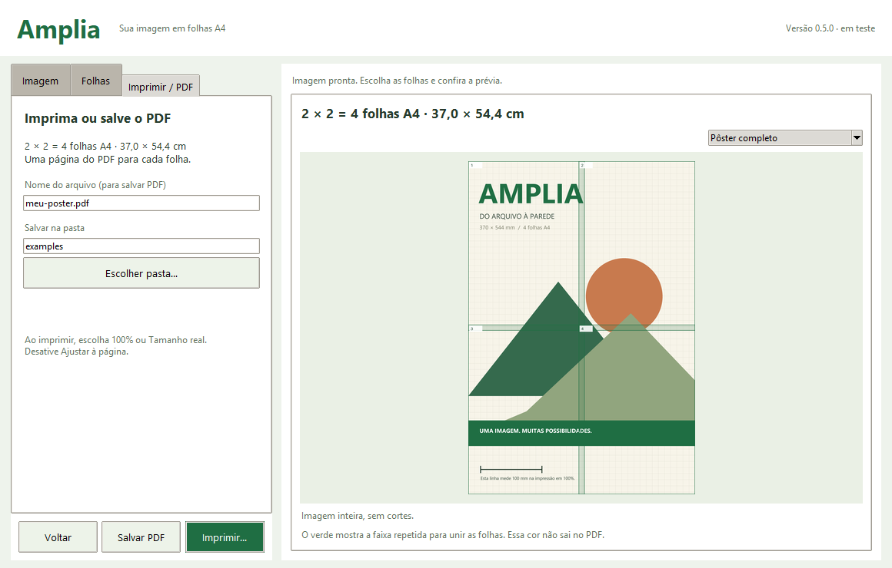

<!-- Amplia · © 2026 Heraldo Antunes · SPDX-License-Identifier: MIT -->
<p align="center"></p>

#  Amplia

[](https://github.com/HeraldoAntunes/amplia/actions/workflows/testes.yml)
[](https://github.com/HeraldoAntunes/amplia/actions/workflows/codeql.yml)
[](https://scorecard.dev/viewer/?uri=github.com/HeraldoAntunes/amplia)
[](https://github.com/HeraldoAntunes/amplia/releases/tag/v0.5.0-rc.1)
[](https://github.com/HeraldoAntunes/amplia/releases)
[](LICENSE)
[](#sistemas-e-limitações)

**Amplie imagens em pôsteres para imprimir em folhas A4, com prévia e ajuda de montagem.**
Aplicativo livre e offline para Windows, com interface nativa. Escolha uma
imagem, defina as folhas e imprima ou salve o PDF. Sem conta ou anúncios.

[Baixar para testar](https://github.com/HeraldoAntunes/amplia/releases/tag/v0.5.0-rc.1) ·
[Guia de uso](docs/GUIA-DE-USO.md) · [Novidades](CHANGELOG.md) ·
[Comandos](docs/COMANDOS.md) · [Arquitetura](docs/ARQUITETURA.md)

## Qual arquivo baixar?

**Pré-lançamento 0.5.0-rc.1: versão em desenvolvimento, para testes.**
**Versão em preparação: 0.5.0**, identificada também no programa como “em teste”.
Ainda não há versão pública estável. Não use esta candidata como única cópia
de um trabalho importante. A licença é [MIT](LICENSE), sem garantia.

| Uso | Arquivo |
| --- | --- |
| Usar sem instalar, no Windows | [**Amplia-0.5.0-rc.1-portatil.zip**](https://github.com/HeraldoAntunes/amplia/releases/download/v0.5.0-rc.1/Amplia-0.5.0-rc.1-portatil.zip) |
| Conferir a integridade do download | [SHA256SUMS.txt](https://github.com/HeraldoAntunes/amplia/releases/download/v0.5.0-rc.1/SHA256SUMS.txt) |

Extraia a pasta completa e abra **Amplia.exe**. Mantenha todos os arquivos juntos.
O runtime Python está incluído; não é necessário instalar Python para usar o
portátil. Para quem trabalha com o código, **Iniciar-Amplia.cmd** abre o pacote
em **dist/Amplia-0.5.0** quando disponível. Ainda não há instalador ou atualização automática.

Para conferir o ZIP, baixe também o SHA256SUMS e execute `certutil -hashfile
Amplia-0.5.0-rc.1-portatil.zip SHA256` na pasta do download. Compare o resultado
com a linha correspondente. Veja [assinatura e segurança](.github/SECURITY.md).

## O que faz

- Abre PNG, JPEG, WebP, BMP e TIFF.
- Define o tamanho por quantidade de folhas ou por medidas em milímetros.
- Divide em A4 retrato ou paisagem, com margens e sobreposição.
- Mostra o pôster completo e as folhas individuais.
- Imprime pelo diálogo do Windows ou salva PDF em tamanho real, com ajuda de montagem.
- Oferece console JSON e protocolo de terminal com resultados estruturados.
- Mostra versão, privacidade e créditos em Ajuda → Sobre o Amplia.

## Começar

1. Na etapa **Imagem**, clique em **Escolher imagem…** ou use a imagem de exemplo.
2. Na etapa **Folhas**, escolha um tamanho pronto ou ajuste horizontal e vertical.
3. Confira a prévia, atualizada automaticamente, e clique em **Continuar**.
4. Na aba **Imprimir / PDF**, clique em **Imprimir…** ou escolha nome e pasta e use **Salvar PDF**.
5. Imprima em **100% / tamanho real**, sem ajustar à página.

As medidas e os ajustes de impressão continuam em **Por medidas (mm)** e
**Ajustes de impressão…**. Veja [como recortar e montar](docs/GUIA-DE-USO.md#recortar-e-montar-as-folhas).

## Privacidade

A interface nativa processa a imagem no computador. Não tem telemetria, conta,
consulta automática de atualização ou envio de imagem. Não abre servidor HTTP.
Os PDFs e as prévias são gravados somente nos destinos solicitados.
A sessão fica na memória e não é recuperada depois de fechar.
A [política de segurança](.github/SECURITY.md) também descreve o servidor opcional
da interface web de desenvolvimento.

## Como é



## Usar por comandos

```powershell
.\dist\Amplia-0.5.0\Amplia.Comandos.exe --stdio
```

Uma requisição e uma resposta JSON por linha, na mesma sessão:

```json
{"comando":"programa.sobre"}
{"comando":"comandos.listar"}
{"comando":"imagem.abrir","parametros":{"caminho":"examples/demo.png"}}
{"comando":"poster.configurar","parametros":{"colunas":2,"linhas":2}}
{"comando":"pdf.exportar","parametros":{"caminho":"output/meu-poster.pdf"}}
```

Os caminhos relativos usam a pasta de trabalho do processo; a pasta de destino
precisa existir. Veja [todos os comandos e parâmetros](docs/COMANDOS.md).

## Executar e testar o código

Requer Python com Tk, Pillow e ReportLab. Os intervalos de versão aceitos estão
em requirements.txt. Para os testes de PDF, também são usados pypdf e PyMuPDF
quando disponíveis. Não há instalação automática de dependências.

```powershell
python amplia_desktop.py
python -m unittest discover -s tests -v
```

Para gerar a imagem de calibração e seu PDF:

```powershell
python examples/criar_demo.py
python amplia.py --batch examples/demo.json
```

O construtor `native/build_portable.py` monta o portátil com componentes já
presentes no ambiente. Mudanças nas fontes podem ser atualizadas com
`--somente-fontes`; mudanças no lançador C exigem recompilação.
Mudanças em VERSION ou no ícone também exigem recompilar os recursos dos executáveis
com `--atualizar-fontes`, para que as propriedades do Windows acompanhem o programa.
O build completo foi preparado para Python 3.14/Tk 9 no Windows.

## Sistemas e limitações

A candidata foi testada em Windows 11 dentro de uma VM, com prévia, PDF e
impressão virtual. Não há teste em outro computador,
Linux ou macOS. A seleção usa a janela do Windows, com navegação por pastas, unidades e atalhos.
O caminho completo continua como alternativa na etapa Imagem. A impressão física não foi validada.

Até 40 MiB e 40 milhões de pixels por imagem, 400 folhas e dimensões de
10 a 5000 mm. Sem projeto salvo ou gestão de cor ICC.
A qualidade da ampliação depende da resolução da imagem.

## Como foi feito

Desenvolvimento com assistência do Codex, da OpenAI, sob direção humana.
A IA é ferramenta de programação, não coautora. Consulte [autoria](AUTORES.md),
[licença](LICENSE) e [componentes de terceiros](THIRD-PARTY-NOTICES.md).
Os metadados para citação ficam em [CITATION.cff](CITATION.cff), sem DOI ou
ORCID ou DOI atribuídos antes de confirmação.

## Programas Livres

O Amplia adota a organização de uso, documentação e distribuição da família
Programas Livres, que também inclui Giz Livre, Giz na Tela, Bancada Livre e
Tarja Livre. Cada programa tem finalidade e numeração próprias.

As marcas citadas pertencem aos seus donos; o Amplia é um projeto independente,
sem vínculo com elas. Fornecido sem garantia, conforme a licença MIT.
