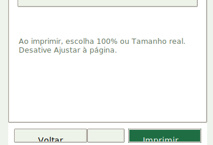
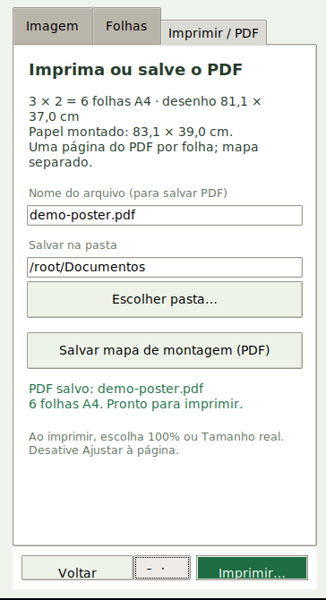
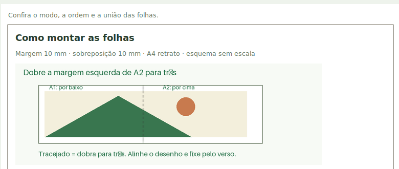

<!-- Amplia · © 2026 Heraldo Antunes · SPDX-License-Identifier: MIT -->
# Validação do Amplia no Linux

Relatório da Gestão dos Programas Livres, feito a pedido do professor Heraldo.
Este ramo (`validacao-linux`) só traz este relatório e três capturas de tela.
**Nenhum arquivo do programa foi alterado.** Os defeitos estão descritos, não corrigidos.

- **Data:** 02/11/2026
- **Código avaliado:** `main` no commit `df6eb29` (versão 0.6.1, candidata publicada 0.6.1-rc.1)
- **Onde:** sessão na nuvem, contêineres Docker, tela virtual Xvfb (sem gerenciador de janelas)
- **Dados:** só os exemplos fictícios do próprio repositório (`examples/`)

## Resumo

| Item | Resultado |
|---|---|
| 1. Suíte de testes (mesmo comando do CI) | **Passou com ressalva:** 68 de 72 passam; 3 falham porque simulam a impressão do Windows; 1 é pulado (portátil do Windows) |
| 2a. Ubuntu 24.04 | **Passou:** instala, testa, abre a interface e gera os PDFs |
| 2b. Debian 12 | **Passou** (com Python oficial na imagem `python:3.11-bookworm`, ver observação) |
| 2c. Ubuntu 22.04 com o Python do sistema (3.10) | **Falhou:** as dependências exigidas não instalam (defeito D1) |
| 2d. Ubuntu 22.04 com Pillow 12.3 (fora dos requisitos) | Funciona; só para diagnóstico |
| 3. PDFs dos exemplos (2 modos × 2 orientações × 3 exemplos) | **Passou:** 12 cartazes e 12 mapas conferidos, 0 falhas; PDFs idênticos byte a byte nos três sistemas |
| 3b. Interface no Linux | **Falhou em parte:** botões cortados e um botão escondido em 1366×768 (D2), acento quebrado na ajuda F1 (D3) |
| 4. Referência ao programa original | **Passou:** nenhum nome ou link de outro programa; há um indício a avaliar (pasta `original/`) |

## 1. Suíte de testes

O CI (`.github/workflows/testes.yml`) roda no Windows: instala `requirements-validado.txt`,
monta o portátil e executa `python -m unittest discover -s tests -v`.
No Linux não há como montar o portátil (usa GCC/windres do Windows), então foi rodado o mesmo comando de teste:

```bash
python3 -m venv /venv
. /venv/bin/activate
pip install -r requirements-validado.txt
xvfb-run -a -s "-screen 0 1366x768x24" python -m unittest discover -s tests -v
```

| Sistema | Python | Pillow | Executados | Passaram | Erros | Pulados |
|---|---|---|---|---|---|---|
| Ubuntu 24.04.5 | 3.12.3 | 13.0.0 | 72 | 68 | 3 | 1 |
| Debian 12.15 | 3.11.18 | 13.0.0 | 72 | 68 | 3 | 1 |
| Ubuntu 22.04.5 (requisitos oficiais) | 3.10.12 | não instala | 10 | 4 | 6 | 0 |
| Ubuntu 22.04.5 (Pillow 12.3.0) | 3.10.12 | 12.3.0 | 72 | 68 | 3 | 1 |

Os 3 erros são os mesmos em todos os sistemas, em `tests/test_print.py`:

- `test_cancel_sends_no_job_and_keeps_configuration`
- `test_driver_failure_aborts_started_job_and_releases_dc`
- `test_selected_range_uses_core_page_renderer_and_releases_dc`

Causa: os testes fazem `patch('amplia_print.ct.WinDLL', ...)`, e `ctypes.WinDLL` só existe no Windows
(`AttributeError: module 'ctypes' does not have the attribute 'WinDLL'`). É limite dos testes, não do programa:
a impressão direta é declarada como só do Windows. O teste pulado é
`test_portable_copy_uses_own_runtime_and_generates_identical_pdf`, que precisa do portátil do Windows.

Os 6 erros no Ubuntu 22.04 com requisitos oficiais são falhas de importação (`No module named 'PIL'`), por causa do defeito D1.

## 2. Montar e rodar o programa

Comando de cada rodada (o roteiro `dentro.sh` está no apêndice):

```bash
docker run --rm --network host \
  -v "$PWD":/src:ro -v "$VAL":/val:ro -v "$RES":/out \
  mirror.gcr.io/library/ubuntu:24.04 bash /val/dentro.sh ubuntu-24.04
```

Na nuvem foi preciso também `-e PIP_CERT=/ca.crt -v /root/.ccr/ca-bundle.crt:/ca.crt:ro`, só por causa do proxy da sessão.
As imagens vieram de `mirror.gcr.io` porque o Docker Hub respondeu "429 Too Many Requests".

| Imagem | Digest |
|---|---|
| `ubuntu:22.04` | `sha256:076e7bf82319619f28dd0aa9c02ab34b055ad37100395b4f49a2ffba04fb5e11` |
| `ubuntu:24.04` | `sha256:fe81560990fae86dc4743202b2cb4d3df98d0bcf949173cecef15ce1127ef852` |
| `python:3.11-bookworm` | `sha256:84fa927127b46670e768371d1ad1be271d57ba93a6fbb3479045c7c6c452432f` |

**Observação sobre o Debian 12:** a política de rede desta sessão bloqueou `deb.debian.org` (403 no proxy),
então não foi possível usar o `apt` do Debian. A rodada usou a imagem oficial `python:3.11-bookworm`
(base Debian 12.15, Python 3.11.18 compilado pela imagem, não o pacote `python3` do Debian, que é 3.11.2)
e a tela Xvfb da máquina hospedeira, pelo soquete `/tmp/.X11-unix`.
Vale repetir num Debian 12 comum com `apt install python3-tk` quando houver acesso.

Em cada sistema a interface (`python amplia_desktop.py`) ficou aberta por 12 segundos sem erro e foi capturada.
No Ubuntu 24.04 a interface também foi usada com cliques simulados (`xdotool`), em telas 1366×768 e 1920×1080:

| Ação | Resultado |
|---|---|
| Abrir, **Usar imagem de exemplo** | Passou; prévia 2 × 2 do mapa |
| **Escolher imagem…** | Passou; abre o seletor do Tk (em inglês, começa em `/root`) |
| Folhas 3 × 2, paisagem, com dobra | Passou; mostra "desenho 81,1 × 37,0 cm", igual à captura do README |
| **Salvar PDF** | Passou em 1920×1080 (6 páginas). SHA-256 idêntico ao PDF feito por comando |
| **Salvar mapa de montagem (PDF)** | Passou; cria `demo-poster-mapa.pdf`, como o guia promete |
| **Imprimir…** | Mostra "A impressão direta está disponível no Windows. Use Salvar PDF neste sistema." Correto |
| **F1** (ajuda de montagem) | Abre, mas com acento quebrado no esquema (D3) |
| Tela 1366×768 | Barra com Voltar, Salvar PDF e Imprimir não aparece (D2) |

## 3. PDFs dos exemplos públicos

Exemplos: `mapa-serra-clara.png`, `peca-suporte.png`, `festa-entre-estrelas.png`
(o botão "Usar imagem de exemplo" usa `demo.png`, que é o mesmo arquivo do mapa: SHA-256 igual).
Configuração: 3 × 2 folhas (o exemplo do README), margem 10 mm, sobreposição 10 mm, guias ligadas,
modos `dobrar` e `inteiras`, orientações `retrato` e `paisagem`.
Gerados pelo protocolo `python amplia.py --stdio`, com `pdf.exportar` e `mapa.exportar` (roteiro `gerar.py` no apêndice).

### O que foi conferido, comparado com o README e o guia

| Promessa | Como foi conferido | Resultado |
|---|---|---|
| Uma página por folha A4 | número de páginas = colunas × linhas = 6 | Passou nos 12 |
| A4 na orientação escolhida | caixa de cada página: 210 × 297 mm (retrato) ou 297 × 210 mm (paisagem) | Passou nos 12 |
| O PDF mantém a imagem original | a imagem embutida tem o mesmo tamanho em pixels do PNG | Passou nos 12 |
| Códigos A1, A2, A3 na primeira linha; B1, B2, B3 na segunda | texto `A1 \| FOLHA 1/6 \| CIMA` e `A1 \| 100%` em cada página | Passou nas 72 páginas |
| Cada folha identifica os vizinhos | `PROXIMA: A2`, `ABAIXO: B1` etc. onde há vizinho | Passou |
| Com dobra: tracejado indica a dobra | 1 tracejado nas folhas da 1ª linha a partir da 2ª coluna, 1 na 2ª linha 1ª coluna, 2 nas demais; total 7 | Passou |
| Folhas inteiras: sem dobra | nenhum tracejado e aviso `FOLHA INTEIRA: NAO CORTAR NEM DOBRAR` | Passou |
| Folhas inteiras: faixa interna de 20 mm com margem de 10 mm | `faixa_branca_interna_mm = 20`, sobreposição efetiva 0 | Passou |
| Desenho e papel montado distintos | inteiras: desenho C × u por R × v, papel C × 210 por R × 297 (ou o inverso); dobra: u + (C - 1)(u - s) | Passou |
| Mapa de montagem em PDF separado | arquivo à parte, 1 página A4 retrato, título, grade "3 colunas x 2 linhas \| 6 folhas A4", todos os códigos e instruções do modo | Passou nos 12 |
| SHA-256 informado pelo comando | igual ao do arquivo gravado | Passou |

Uma página de cada modo e um mapa também foram vistos em imagem (`pdftoppm`): tracejado à esquerda e em cima
e sinais **+** no modo com dobra; nenhum tracejado no modo folhas inteiras.

Medidas obtidas (iguais para os três exemplos):

| Modo e orientação | Desenho (mm) | Papel montado (mm) |
|---|---|---|
| dobrar, retrato | 550 × 544 | 570 × 564 |
| dobrar, paisagem | 811 × 370 | 831 × 390 |
| inteiras, retrato | 570 × 554 | 630 × 594 |
| inteiras, paisagem | 831 × 380 | 891 × 420 |

O cartaz de festa recebe o aviso de resolução abaixo de 100 dpi (59 a 82 dpi), como o README explica.

### SHA-256 dos PDFs gerados

Os 24 arquivos deram **o mesmo SHA-256** no Ubuntu 24.04, no Debian 12 e no Ubuntu 22.04 com Pillow 12.3
(o ReportLab é usado com `invariant=True`, então a saída não depende da data nem do sistema).

| Cartaz | SHA-256 do cartaz | SHA-256 do mapa |
|---|---|---|
| mapa-serra-clara, dobrar, retrato | `3c21dc276a96612416253bab2d19b140f24a33b409d07b0eb46ca873808aa02e` | `3e45d12d433e2c1551220107fcc97472de408f3161046b28e593e1204afc5b02` |
| mapa-serra-clara, dobrar, paisagem | `73993bf616645827a931617154d44b1b765fbe7f6d1fc408fa0dd8b4231ffd09` | `8e09d645bbc5009f9afd2920185d3d5848085a83b48b89003da31e027d18d6ae` |
| mapa-serra-clara, inteiras, retrato | `193f59ebb942a2f22cf8c39277dca311c9f1d2af4c298ae805fcccb6538f0316` | `a34c78552b211c31dc1fbb1f17caa35005afc31585a2ae22cf71df00858760ba` |
| mapa-serra-clara, inteiras, paisagem | `0162f26eb4d9f30577b3224a4d89ae22d9e347231bad6d03bb4de0389e5f727e` | `54c4cda06f1351ffcb5406f5b601a57615bf4c8f1fa3f42a059d3e34a661d2c0` |
| peca-suporte, dobrar, retrato | `ebc425c13d3c89eb09f51fe109d9565d1ee6e83bb20b2cc3c1eefe45c93a09ab` | `3e45d12d433e2c1551220107fcc97472de408f3161046b28e593e1204afc5b02` |
| peca-suporte, dobrar, paisagem | `9084c53d5771aaa6461be96b3eea6b588125f1b5edf6ebb97e88ad30f4390a71` | `8e09d645bbc5009f9afd2920185d3d5848085a83b48b89003da31e027d18d6ae` |
| peca-suporte, inteiras, retrato | `eac128df60e7f2b58e180a86e8c242f77ebdc27bf78edf37333f018aa6c321a0` | `a34c78552b211c31dc1fbb1f17caa35005afc31585a2ae22cf71df00858760ba` |
| peca-suporte, inteiras, paisagem | `958e38b9da831daf0649a8e1336fa01f0689d6a3078adb3b64189ea40ad317ab` | `54c4cda06f1351ffcb5406f5b601a57615bf4c8f1fa3f42a059d3e34a661d2c0` |
| festa-entre-estrelas, dobrar, retrato | `e69781a5ec6ce0a6b74bbc6a3db15af6ec9cdc9bec7b80471cb6e4cf456f3a70` | `3e45d12d433e2c1551220107fcc97472de408f3161046b28e593e1204afc5b02` |
| festa-entre-estrelas, dobrar, paisagem | `2aa1e08b165980240109c483b8669c80852766228e581bcd5a95b43ca370c946` | `8e09d645bbc5009f9afd2920185d3d5848085a83b48b89003da31e027d18d6ae` |
| festa-entre-estrelas, inteiras, retrato | `d3929b7ade3dca16096e17c52f4fa173ccc2f5a1f890c34bc53738481a590a51` | `a34c78552b211c31dc1fbb1f17caa35005afc31585a2ae22cf71df00858760ba` |
| festa-entre-estrelas, inteiras, paisagem | `d6a534ee1d5539519259fcdfbe250904fa458843f2fe42a574db70ef0c35a44b` | `54c4cda06f1351ffcb5406f5b601a57615bf4c8f1fa3f42a059d3e34a661d2c0` |

O mapa não contém a imagem, por isso é igual entre exemplos com o mesmo modo e orientação.
O PDF e o mapa salvos pela interface (mapa, 3 × 2, dobra, paisagem) deram `73993bf6…1ffd09` e `8e09d645…18d6ae`,
os mesmos da linha correspondente acima.

## 4. Referência ao programa original

Regra: sem referência ao programa estudado. Foi procurado em todos os arquivos versionados, nas mensagens de
todos os 10 commits, nos diffs do histórico e nos metadados das imagens (PNG, SVG, ICO):

```bash
P='raster ?bat|posterazor|poste ?razor|block ?poster|posterizer|poster ?printer|pdfposter|poster ?forge|posterprint|easy ?poster|poster ?maker|pospopo|ace ?poster|inspirad|baseado em|clone|original program|programa original|programa estudado|semelhante ao|similar to|alternativa ao|alternative to'
git grep -niE "$P" -- . ':!*.png'
git log --all --format='%H %s%n%b' | grep -niE "$P"
git log --all -p | grep -iE "^[+-].*(raster ?bat|posterazor|block ?poster|pdfposter|posterizer|inspirad|programa original|programa estudado)"
git grep -niE "estudad|estudo|concorrente|referência ao|inspira|equivalente ao|programa de refer|software de refer"
```

**Resultado: nenhum nome, link ou menção a outro programa de pôster.** Pontos para a gestão avaliar:

1. **Indício: pasta `original/`.** Ela está no `.gitignore` (linha 7) e o código protege essa pasta:
   `amplia.py:104-106` recusa gravar dentro dela com a mensagem visível
   "A pasta original é reservada para preservação." (`ORIGINAL_PROTEGIDO`). Há teste para isso em
   `tests/test_amplia.py:219-226`. A pasta nunca foi versionada. Não cita nenhum programa, mas para quem lê
   o código ou recebe o erro pode sugerir que existe um "original" guardado junto do projeto.
2. **Metadados C2PA em `examples/festa-entre-estrelas.png`:** "ChatGPT", "gpt-image", "OpenAI Media Service API".
   Está de acordo com o README, que já declara que o cartaz foi gerado com IA da OpenAI. Não é referência ao programa estudado.
   A data no selo é 2026-11-02T00:21:56Z, depois da candidata 0.6.1-rc.1 (01/11); o cartaz da `main` pode não ser o mesmo do ZIP publicado.
3. As outras imagens (capturas, ícone, mapa, peça) não têm texto de metadados.

## Defeitos encontrados

### D1. Ubuntu 22.04: dependências não instalam com o Python do sistema

**Gravidade:** média para quem usa Linux pelo código (o README já diz que Linux não foi validado).

Passo a passo:

1. Num Ubuntu 22.04 limpo: `apt install python3 python3-venv python3-tk`.
2. `python3 -m venv venv && . venv/bin/activate`
3. `pip install -r requirements.txt` (ou `requirements-validado.txt`).

Esperado: dependências instaladas. Obtido:
`ERROR: Ignored the following versions that require a different python version: 13.0.0 Requires-Python >=3.11`
e `No matching distribution found for Pillow<14,>=13`. O programa não abre (`No module named 'PIL'`).

Causa: `requirements.txt` exige Pillow 13, que pede Python 3.11 ou mais novo; o Ubuntu 22.04 traz 3.10.12.
O README não informa a versão mínima de Python. Com Pillow 12.3.0 (fora do intervalo) tudo funciona e os PDFs saem idênticos.

### D2. Interface no Linux: botões cortados e barra de ações escondida em 1366×768

**Gravidade:** alta no Linux com tela 1366×768 (não dá para clicar em Salvar PDF); baixa em telas maiores.

Passo a passo (Ubuntu 24.04, Xvfb 1366×768, `fonts-dejavu-core`):

1. `python amplia_desktop.py`
2. Clique em **Usar imagem de exemplo** e abra a aba **Imprimir / PDF**.

Esperado (como na captura do README no Windows): botões **Voltar**, **Salvar PDF** e **Imprimir…** embaixo.
Obtido: a barra de baixo não aparece. Mesmo com a janela redimensionada para a tela inteira (`xdotool windowsize`),
ela fica cortada e o botão do meio aparece vazio. O menu **Arquivo → Salvar PDF…** (Ctrl+Shift+S) só leva até a aba, não salva.



Em 1920×1080 a barra aparece, mas:

- o botão **Salvar PDF** fica espremido e ilegível ("- ."), entre Voltar e Imprimir;
- os textos de **Voltar**, **Continuar** e **Imprimir…** ficam cortados embaixo;
- na aba **Folhas**, o atalho **9 folhas** aparece como "9 fo".



Causa provável: no Linux o Tk usa outra fonte (DejaVu Sans), mais larga e mais alta que a Segoe UI do Windows,
e `initial_geometry` (`amplia_desktop.py:24-37`) limita a janela a 1160 × 740 e, fora do Windows, desconta só 110 px da altura da tela.
Teste feito sem gerenciador de janelas; vale confirmar num desktop Linux real.

### D3. Ajuda de montagem (F1): "trás" aparece como "tr�s" no esquema

**Gravidade:** baixa (texto visível ao usuário, sentido ainda compreensível).

Passo a passo (Ubuntu 24.04, com ou sem `fonts-dejavu-core`):

1. `python amplia_desktop.py`, clique em **Usar imagem de exemplo**.
2. Tecle **F1**.

Esperado: "Dobre a margem esquerda de A2 para trás" e "Tracejado = dobra para trás".
Obtido: "para tr�s" nas duas frases do desenho (o texto abaixo do desenho sai correto).



Causa: `amplia_desktop.py:44-46` só procura `C:/Windows/Fonts/segoeui.ttf`; fora do Windows usa
`ImageFont.load_default(size=...)`, que é a fonte Aileron embutida no Pillow e não tem a letra "á".
Conferido: `ImageFont.load_default(size=20).getname()` devolve `('Aileron', 'Regular')` e o desenho de "á" é igual ao de um caractere ausente.

### Observações menores (não bloqueiam)

- **O1.** No Linux, ao clicar em **Escolher imagem…**, a mensagem diz "Escolha a imagem na janela do Windows" e o seletor do Tk aparece em inglês (Directory, File name, Open, Cancel).
- **O2.** PDFs gravados no Linux ficam com permissão `-rw-------` (só o dono lê), mesmo com `umask 0000`. Vem de `tempfile.mkstemp` em `atomic_write` (`amplia.py:109`), que cria o temporário com 0600 e o arquivo final herda. Outros usuários do mesmo computador não conseguem abrir o PDF.
- **O3.** A pasta sugerida para salvar é a pasta da imagem (com o exemplo, `examples/` do programa).
- **O4.** `folhas.listar` às vezes devolve `-0.0` (por exemplo `imagem_no_poster_mm.x`). Só estético.

## Apêndice: roteiros usados

Ficaram fora do repositório para não mudar o programa. Reproduzidos aqui para quem quiser repetir.

<details>
<summary><code>dentro.sh</code> (roda dentro de cada contêiner)</summary>

```bash
#!/bin/bash
# Roda dentro do contêiner. /src = repositório (só leitura), /out = resultados.
set -u
export DEBIAN_FRONTEND=noninteractive
NOME="$1"; OUT="/out/$NOME"; mkdir -p "$OUT"
exec > >(tee "$OUT/log.txt") 2>&1
echo "== sistema"; grep PRETTY_NAME /etc/os-release
if [ -z "${SEM_APT:-}" ]; then apt-get update -qq && apt-get install -y -qq python3 python3-venv python3-pip python3-tk xvfb xauth poppler-utils >/dev/null; fi
python3 --version; python3 -c "import tkinter; print('Tk', tkinter.TkVersion)"
cp -r /src /work && cd /work
python3 -m venv /venv && . /venv/bin/activate
pip install -q --upgrade pip >/dev/null
echo "== pip requirements-validado.txt"
if pip install -q -r requirements-validado.txt; then echo "REQ_VALIDADO=ok"; else echo "REQ_VALIDADO=falhou"; if [ -n "${PACOTES_ALTERNATIVOS:-}" ]; then pip install -q $PACOTES_ALTERNATIVOS && echo "PACOTES_ALTERNATIVOS=ok ($PACOTES_ALTERNATIVOS)"; fi; fi
pip freeze | grep -iE "pillow|reportlab|pypdf|pymupdf|chardet"
echo "== testes"
TELA="xvfb-run -a -s -screen\ 0\ 1366x768x24"; [ -n "${DISPLAY_EXTERNO:-}" ] && TELA="env DISPLAY=$DISPLAY_EXTERNO"
eval $TELA python -m unittest discover -s tests -v > "$OUT/testes.txt" 2>&1; echo "TESTES_SAIDA=$?"
tail -5 "$OUT/testes.txt"
echo "== interface"
D=${DISPLAY_EXTERNO:-:77}; XP=
[ -z "${DISPLAY_EXTERNO:-}" ] && { Xvfb :77 -screen 0 1366x768x24 & XP=$!; sleep 2; }
DISPLAY=$D python amplia_desktop.py > "$OUT/interface.txt" 2>&1 & AP=$!
sleep 12
if kill -0 $AP 2>/dev/null; then echo "INTERFACE=aberta"; else wait $AP; echo "INTERFACE=encerrou codigo $?"; fi
python -c "from PIL import ImageGrab; ImageGrab.grab(xdisplay='$D').save('$OUT/interface.png')" || echo "captura falhou"
kill $AP 2>/dev/null; wait $AP 2>/dev/null; [ -n "$XP" ] && kill $XP
cat "$OUT/interface.txt"
echo "== pdfs"
python /val/gerar.py /work "$OUT"; echo "PDFS_SAIDA=$?"
```

Rodadas: `ubuntu:22.04` e `ubuntu:24.04` sem variáveis extras; Ubuntu 22.04 com
`-e PACOTES_ALTERNATIVOS="Pillow==12.3.0 reportlab==4.1.0 chardet==7.4.3 pypdf==6.21.4 PyMuPDF==1.27.2.3"`;
Debian com `python:3.11-bookworm`, `-e SEM_APT=1 -e DISPLAY_EXTERNO=:88 -v /tmp/.X11-unix:/tmp/.X11-unix`
e `Xvfb :88` rodando na máquina hospedeira.

</details>

<details>
<summary><code>gerar.py</code> (gera e confere os PDFs)</summary>

```python
"""Gera e confere os PDFs dos exemplos públicos pelo protocolo --stdio do Amplia."""
import hashlib
import json
import math
import re
import subprocess
import sys
from pathlib import Path

from pypdf import PdfReader

ROOT, OUT = Path(sys.argv[1]), Path(sys.argv[2])
PDF = OUT / 'pdfs'
PDF.mkdir(parents=True, exist_ok=True)
EXEMPLOS = ['mapa-serra-clara', 'peca-suporte', 'festa-entre-estrelas']
COLS, ROWS = 3, 2
PT = 72 / 25.4
falhas, linhas = [], []


def checar(cond, texto):
    if not cond:
        falhas.append(texto)
    return cond


def codigo(r, c):
    return chr(65 + r) + str(c + 1)


for ex in EXEMPLOS:
    for modo in ('dobrar', 'inteiras'):
        for ori in ('retrato', 'paisagem'):
            nome = f'{ex}-{modo}-{ori}'
            cartaz, mapa = PDF / f'{nome}.pdf', PDF / f'{nome}-mapa.pdf'
            pedidos = [
                {'comando': 'imagem.abrir', 'parametros': {'caminho': str(ROOT / 'examples' / f'{ex}.png')}},
                {'comando': 'poster.configurar', 'parametros': {'colunas': COLS, 'linhas': ROWS, 'margem_mm': 10,
                 'sobreposicao_mm': 10, 'orientacao': ori, 'montagem': modo, 'marcas': True}},
                {'comando': 'folhas.listar'},
                {'comando': 'pdf.exportar', 'parametros': {'caminho': str(cartaz), 'substituir': True}},
                {'comando': 'mapa.exportar', 'parametros': {'caminho': str(mapa), 'substituir': True}},
            ]
            proc = subprocess.run([sys.executable, str(ROOT / 'amplia.py'), '--stdio'], cwd=ROOT,
                                  input='\n'.join(map(json.dumps, pedidos)) + '\n',
                                  capture_output=True, text=True, timeout=300)
            resp = [json.loads(x) for x in proc.stdout.splitlines()]
            if not checar(proc.returncode == 0 and all(r['ok'] for r in resp), f'{nome}: comando falhou {proc.stderr[-500:]} {resp}'):
                continue
            fol = resp[2]['resultado']
            exp = resp[3]['resultado']
            pw, ph = (210, 297) if ori == 'retrato' else (297, 210)
            r = PdfReader(cartaz)
            n = len(r.pages)
            checar(n == COLS * ROWS == exp['paginas'], f'{nome}: {n} páginas, esperado {COLS*ROWS}')
            tamanhos = {(round(float(p.mediabox.width) / PT, 1), round(float(p.mediabox.height) / PT, 1)) for p in r.pages}
            checar(tamanhos == {(pw, ph)}, f'{nome}: papel {tamanhos}, esperado {(pw, ph)}')
            sha = hashlib.sha256(cartaz.read_bytes()).hexdigest()
            checar(sha == exp['sha256'], f'{nome}: SHA informado difere do arquivo')
            # Imagem original preservada no PDF.
            from PIL import Image
            orig = Image.open(ROOT / 'examples' / f'{ex}.png').size
            imgs = [(int(o['/Width']), int(o['/Height'])) for o in
                    (x.get_object() for x in r.pages[0]['/Resources']['/XObject'].values())]
            checar(orig in imgs, f'{nome}: imagem no PDF {imgs}, original {orig}')
            # Guias: códigos, vizinhos e tracejado.
            tracejados = 0
            for i, page in enumerate(r.pages):
                row, col = divmod(i, COLS)
                txt = page.extract_text()
                cod = codigo(row, col)
                checar(f'{cod} | FOLHA {i+1}/{n} | CIMA' in txt, f'{nome} folha {i+1}: falta "{cod} | FOLHA {i+1}/{n} | CIMA"')
                checar(f'{cod} | 100%' in txt, f'{nome} folha {i+1}: falta "{cod} | 100%"')
                if col + 1 < COLS:
                    checar(f'PROXIMA: {codigo(row, col+1)}' in txt, f'{nome} folha {i+1}: falta vizinho à direita')
                if row + 1 < ROWS:
                    checar(f'ABAIXO: {codigo(row+1, col)}' in txt, f'{nome} folha {i+1}: falta vizinho abaixo')
                conteudo = page.get_contents().get_data().decode('latin-1')
                dash = len(re.findall(r'\[\s*[\d.]+\s+[\d.]+\s*\]\s*0\s+d', conteudo))
                tracejados += dash
                if modo == 'inteiras':
                    checar('FOLHA INTEIRA: NAO CORTAR NEM DOBRAR' in txt, f'{nome} folha {i+1}: falta aviso de folha inteira')
                    checar(dash == 0, f'{nome} folha {i+1}: tracejado de dobra no modo folhas inteiras')
                else:
                    esperado = (1 if col else 0) + (1 if row else 0)
                    checar(dash == esperado, f'{nome} folha {i+1}: {dash} tracejados, esperado {esperado}')
                    if col:
                        checar('DOBRE PARA TRAS' in txt, f'{nome} folha {i+1}: falta "DOBRE PARA TRAS"')
            # Geometria prometida.
            u, v = pw - 20, ph - 20
            if modo == 'inteiras':
                checar(fol['faixa_branca_interna_mm'] == 20, f'{nome}: faixa branca {fol["faixa_branca_interna_mm"]}')
                checar(fol['sobreposicao_mm'] == 0, f'{nome}: sobreposição efetiva {fol["sobreposicao_mm"]}')
                checar(fol['poster_mm'] == [COLS * u, ROWS * v], f'{nome}: desenho {fol["poster_mm"]}')
                checar(fol['papel_montado_mm'] == [COLS * pw, ROWS * ph], f'{nome}: papel montado {fol["papel_montado_mm"]}')
            else:
                checar(fol['poster_mm'] == [u + (COLS - 1) * (u - 10), v + (ROWS - 1) * (v - 10)], f'{nome}: desenho {fol["poster_mm"]}')
            # Mapa separado.
            m = PdfReader(mapa)
            mt = m.pages[0].extract_text()
            msize = (round(float(m.pages[0].mediabox.width) / PT, 1), round(float(m.pages[0].mediabox.height) / PT, 1))
            checar(len(m.pages) == 1 and msize == (210, 297), f'{nome}: mapa {len(m.pages)} pág. {msize}')
            checar('Mapa de montagem' in mt and f'{COLS} colunas x {ROWS} linhas | {COLS*ROWS} folhas A4' in mt,
                   f'{nome}: mapa sem título ou grade')
            checar(all(codigo(a, b) in mt for a in range(ROWS) for b in range(COLS)), f'{nome}: mapa sem todos os códigos')
            checar(('Haverá faixas brancas de 20 mm' in mt) if modo == 'inteiras' else ('dobre a margem ESQUERDA' in mt),
                   f'{nome}: mapa sem instrução do modo')
            checar(mapa.read_bytes() != cartaz.read_bytes(), f'{nome}: mapa igual ao cartaz')
            linhas.append(dict(nome=nome, paginas=n, papel_mm=[pw, ph], tracejados=tracejados,
                               desenho_mm=fol['poster_mm'], papel_montado_mm=fol['papel_montado_mm'],
                               dpi=fol['resolucao_efetiva_dpi'], avisos=fol['avisos'],
                               sha256=sha, mapa_sha256=hashlib.sha256(mapa.read_bytes()).hexdigest(),
                               bytes=cartaz.stat().st_size))

(OUT / 'pdfs.json').write_text(json.dumps(dict(linhas=linhas, falhas=falhas), ensure_ascii=False, indent=1), encoding='utf-8')
for item in linhas:
    print(item['nome'], item['paginas'], item['papel_mm'], item['sha256'][:16])
print('FALHAS:', len(falhas))
for f in falhas:
    print(' -', f)
sys.exit(1 if falhas else 0)
```

</details>
